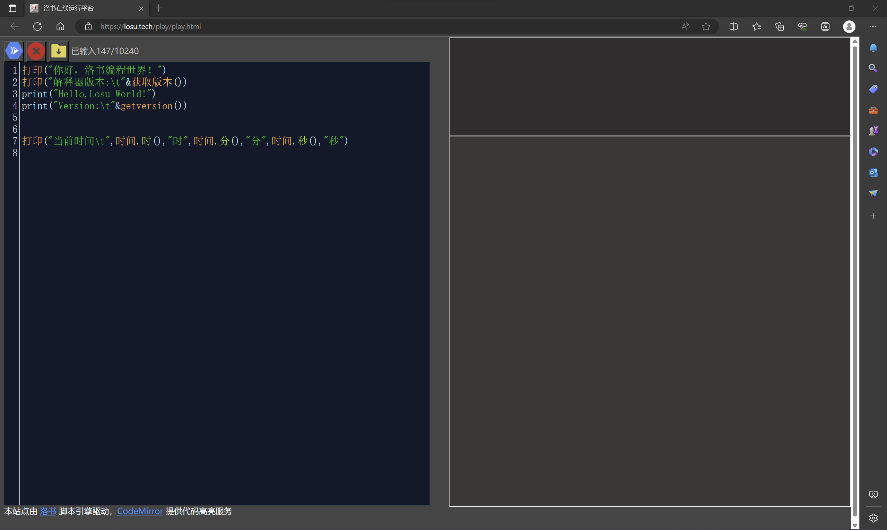

#!/bin/owls.wiki.losu.tech

# 前言
## 致读者
尊敬的读者：
欢迎来到洛书编程语言的语法教程。洛书编程语言是一种新兴的、富有创新性的编程语言，它致力于让编程更加容易，更加高效。在这个教程中，我们将引导您逐步掌握洛书编程语言的基本语法和核心概念，让您轻松掌握这门强大的编程工具。

本教程的目标是帮助您了解洛书编程语言的基本语法规则和编程模式，从而能够编写出正确、有效的代码。我们不仅将为您展示如何使用洛书编程语言进行基本的编程操作，还将分享概念和技巧，以帮助您在编程过程中获得更多的乐趣和成就感。在本教程的编写过程中，我们尽可能地采用了简洁明了的语言，以便于您理解和掌握洛书编程语言。我们还为您准备了一些示例代码，以便于您更好地理解所学内容。

本教程的教学环境为 “洛书在线运行平台” ，您可以访问 [https://losu.tech/playground](https://losu.tech/playground) 以前往。 

最后，请务必遵循洛书编程语言的语法规则和良好的编程习惯，以确保您的代码能够正确地运行。如果您在学习过程中遇到了任何问题或困惑，请随时联系我们，我们将尽力为您提供帮助。

祝您学习愉快！


## 洛书关键词一览表
洛书拥有完整的utf-8编码支持，这意味着您可以使用 英文、中文、emoji 等符合进行编程，洛书官方对中文编程功能进行了支持，在此，我们为您奉上洛书中英文关键词一览表

|英文|中文|
|--|--|
|import| 引|
| $、var|令|
|null|空|
|and| 且|
|def|方法
|return| 回|
|or| 或|
|not| 非|
|for| 计次、列举|
|loop| 重复|
|to| 至|
|with| 当|
|break| 跳出|
|return| 回|
|if| 如果|
|elif| 另外|
|else| 否则|
|arg|变参|
|this|此|
|block|代码块|
|class|构造|
|pass|;|


# 2-1-你好，洛书
## 2-1-1-第一个洛书程序
打印“hello world”是C语言之后的惯用案例，洛书例子打印的是中文“你好，洛书！”

### 2-1-1-1-从终端交互开始
1. 打开终端，输入命令`losu`，Linux 用户推荐使用```rlwrap losu```
2. 输入 ```print('Hello,World!')```,回车
3. 输入 ```打印('你好,洛书')```，回车

### 2-1-1-2-从文件开始
创建 `hello.els`,内容如下

```python
# 这里是注释
import 'stdlib'
print("Hello,Losu world!")
```

其中 `#`开始的是行注释，`import`函数导入了`stdlib`模块，然后使用其中的`print`函数输出文字

那么，使用中文函数的写法如下
```python
引('stdlib')
打印('你好,洛书编程世界!')
```

您可以使用命令 ```losu [文件名]```的方式运行一个洛书程序


### 2-1-1-3-洛书在线运行平台

<!--  -->

+ 您可以通过访问[https://losu.tech/playground](https://losu.tech/playground)前往洛书在线运行平台

+ 在线运行平台的特点包括
    - 免安装，免配置，点开即用，不用引用模块
    - 纯云端运行，不占用本地资源

+ 点击运行图标，即可看到运行效果

## 2-1-2-命令行参数
### 2-1-2-1-查看版本
+ 使用命令 ```losu -v```查看详细的版本信息，包括构建相关的信息
+ 使用命令 ```losu -V```查看简略的版本信息

### 2-1-2-2-运行模块
+ 洛书可以通过解释器将模块以程序的形式执行
+ ```losu -r [名称]```

## 2-1-3-工程与模块化(非强制)
## 2-1-3-1-洛书是一门完全模块化设计的编程语言
洛书采用完全的单位化设计，以模块的形式组织代码，模块可以是一个脚本，也可以是一个预编译的二进制库，洛书发行版自身便是由 `losu_core 内核模块`、`losu 解释器模块`、`stdlib 标准库`与`lpt 模块管理器模块`等模块组合而成

## 2-1-3-2-模块管理工具
洛书包管理工具`Losu Packages Tool`，简称`lpt`，是为洛书设计的一款集 查找、安装、卸载、更新、配置、开发、获取文档等功能于一身的开发工具。其由洛书本身进行实现，具体轻量化、跨平台、易拓展等多种优点。

## 2-1-3-3-洛书工程
+ 洛书拥有一定的工程化机制，可以根据工程实现独立化的运行环境
+ 一个完整的工程目录包括
```
工程/
|—— main.els        # 主脚本
|—— LICENSE         # 版权文件
|—— lib/
|   |—— xxx.lsd     # 依赖的模块
|   |—— ······
|—— README.MD
```
+ 洛书的解释器在执行工程时会优先选择工程内部的模块（优先同目录，后lib/）进行执行，在工程内缺失依赖模块时会尝试从本地加载模块，因此，通过这种容器化机制，可以方便地实现各个工程间独立的运行环境。
