#!/bin/owls.wiki.losu.tech
# 2-程序结构

洛书和其他编程语言一样，也是由小型结构组合成一个大型程序。

洛书采用精简的设计结构，一切洛书程序都是由 变量、数据与语句构成的，本章会向您介绍 变量与数据的相关信息

# 2.1-注释
洛书支持两种方式对代码进行注释
## 2.1.1-单行注释
+ `#`后的一行所有内容都会被视作注释，不产生任何作用
```python
# 这是单行注释
```
## 2.1.2-多行注释
+ ```"""```或```'''```符号包围的区域内，所有的内容都会被视作注释
```python
'''
这里是注释~
多行注释
'''

"""
这里也是注释！
"""
```

# 2.2-全局变量
全局变量是在全局作用域中声明的变量，其声明方式为 ```var 变量名```

```js
var a
a = "hello"
var b = "losu"
var c,d = "hello","losu"

```
全局变量在程序的任何地方都可以使用 —— 哪怕全局变量的声明与使用位于不同的源文件中，只要它们位于同一个虚拟机进程内即可；按照洛书语法规范，您在使用变量前应先对它进行声明，但是全局变量并不要求“先声明再使用”。如果您使用了一个未被声明的变量，它会被放置在全局变量中。

```
在洛书中，所有未被赋值的变量都属于 null(空) 类型，它们不会被GC标记，不会占用运行时内存
```


# 2.3-局部变量与作用域
## 2.3.1-局部变量
+ 局部变量是在局部作用域内被声明的变量
+ 局部变量的作用域是其所在作用域与其相邻的子作用域
+ 与全局变量一样，局部变量也是用`var`函数进行的声明

## 2.3.2-作用域
+ 洛书支持利用`block`关键字指定块状作用域
+ 作用域可以相互嵌套
+ 每一个作用域的局部对象在离开时会被GC销毁

## 2.3.3-样例
### 2.3.3.1-样例一
```python
# 在线运行平台无需引用标准库
# import('stdlib')

var 😏 = "hello"        # 全局变量 😏
block
    # 一个块状作用域
    var 😏 = "hi"       # 局部变量 😏
    print(😏)           # 优先访问局部变量
;
print(😏)               # 局部变量被销毁，访问全局变量
```
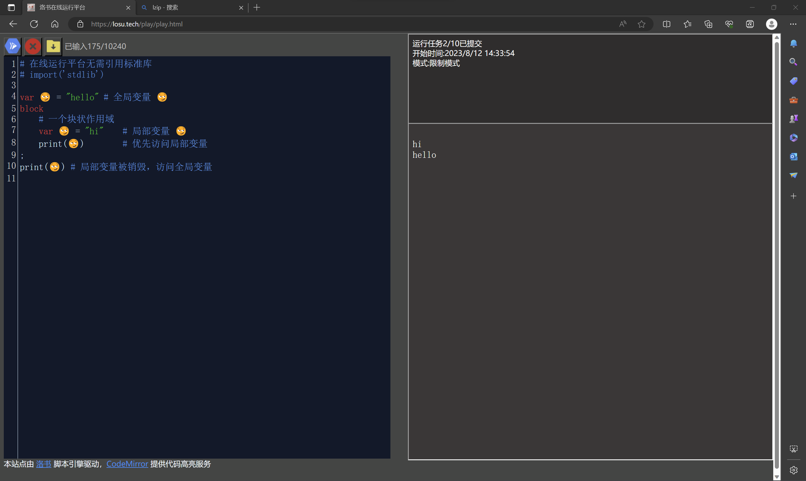

### 2.3.3.2-样例二
```python
# 在线运行平台无需引用标准库
# import('stdlib')

var 😏 = "hello"        # 全局变量 😏
block
    # 一个块状作用域
    var 😏 = "hi"       # 局部变量 😏
    var a = "hee"
    print(😏)           # 优先访问局部变量
    block
        # 再来一个作用域
        print(😏)        # 查找作用域，发现局部变量 😏，优先访问
        var a = "heiii"  # 查找作用域，发现当前块状作用域的局部变量 a，优先访问
        print(a)    
    ;
    print(a)            # 局部 a 被销毁，找到当前的 a
;
print(😏) # 局部变量被销毁，访问全局变量
```
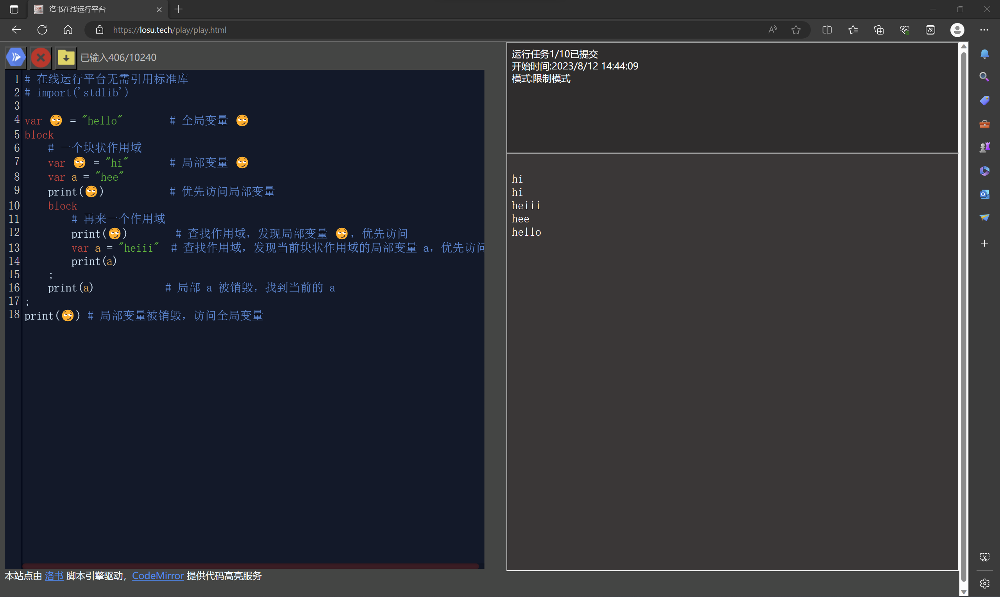

#!/bin/owls.wiki.losu.tech
# 2.4-函数与闭包
洛书的函数本质上是一种`function`类型的变量
## 2.4.1-函数声明
函数声明一般以`def`关键字开始，语法如下，可以使用`return`关键词返回数据，如果没有返回值，则默认是`null`类型

```python
def 函数名(参数列表):
    # 函数体
;
```

如下面的例子

```python
方法 ➕(数字1,数字2):
    回 数字1 + 数字2
;

🙋(➕(1,3))

```
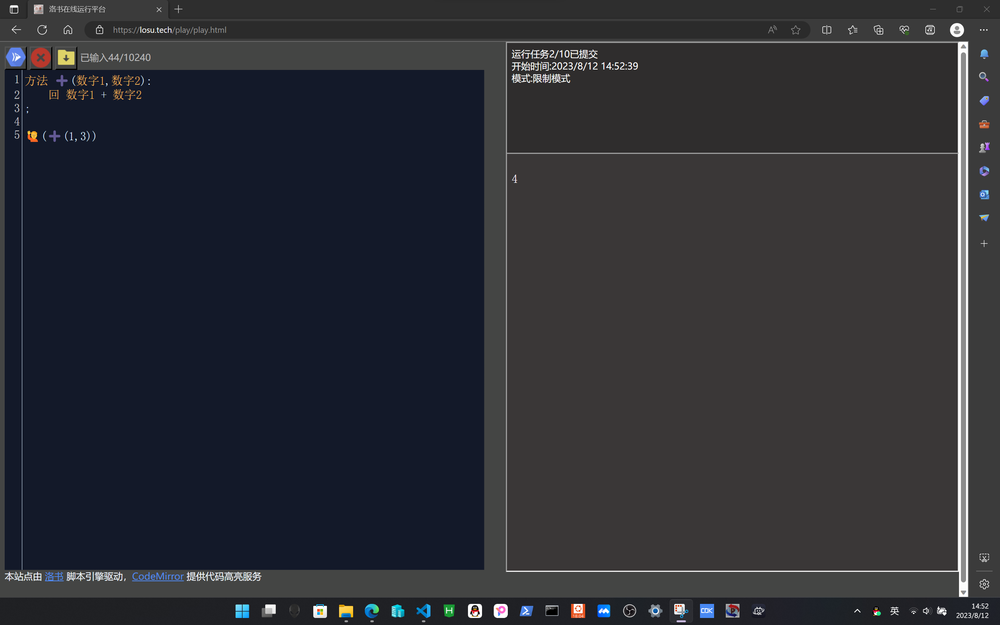

## 2.4.2-闭包
洛书支持高阶函数与闭包，与块状作用域不同，函数中的闭包变量应位于全局变量或相邻作用域内
```python
方法 ➕(数字1,数字2):
    var ➕➕    # 声明局部变量
    def ➕➕(): # 这个函数是一个局部变量
        var ➕➕➕
        var 数字1,数字2 = 数字1,数字2 
        '''
        如果注释上一行，会引起报错 
        闭包变量必须是全局变量 或 位于 上一级作用域中 ,变量 数字1 不满足此条件
        '''
        def ➕➕➕():
            回 数字1 + 数字2
        ;
        return ➕➕➕()
    ;

    return ➕➕()
;

🙋(➕(1,3))
```
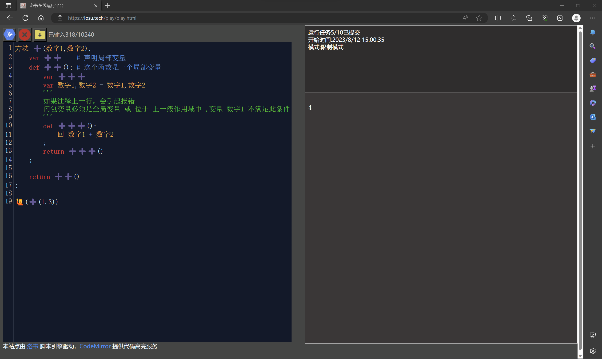

## 2.4.3-函数的覆盖与重写

洛书的函数本质是一个变量，因此，您可以在运行时动态修改函数内容
```python

方法 ➕(数字1,数字2):
    回 数字1 + 数字2
;
🙋(➕(1,3))

方法 ➕(数字1,数字2):
    回 数字1 - 数字2
;
🙋(➕(1,3))

```
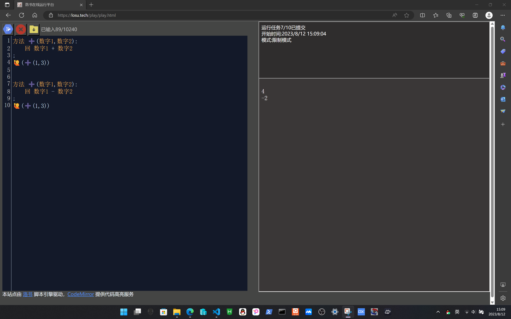

#!/bin/owls.wiki.losu.tech

# 2.5-数据类型
## 2.5.1-洛书数据类型
洛书包含以下数据类型
+ 空 null，一切未被赋值、声明的变量都是null
+ 字符串 string
+ 数字 number
+ 函数 function
+ 单元 unit
+ 指针 ptr
+ 字节 byte

其中，用户可以在脚本层面创建与修改除指针外的所有数据类型，并可在C-脚本接口层面操作指针变量
您可以使用 type/类型 函数来获取一个变量的数据类型

```python
# 在线平台拥有 🔧 函数， 🔧 == type

🙋(🔧(12.33))   # number
🙋(🔧(🔧))      # type本身是 function
🙋(🔧(🔧()))    # type的返回值是string

```
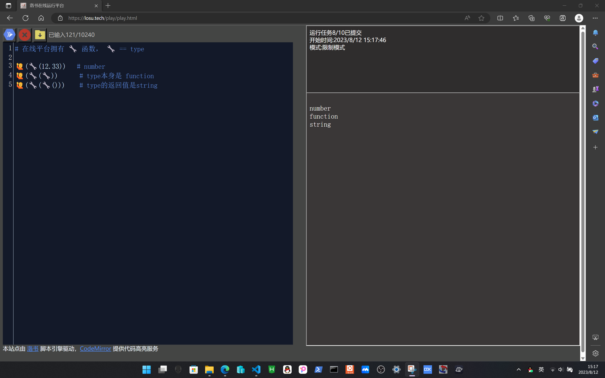

## 2.5.2-洛书变量类型的转换
洛书的字符串与数字支持动态类型转换，同时支持运算符重载(见后续章节)，动态转换会改变变量的数据类型
```python
🍎 = "6"
🙋(🍎)
🙋(🔧(🍎))
🍎 = 🍎 + 1
🙋(🍎)
🙋(🔧(🍎))
```
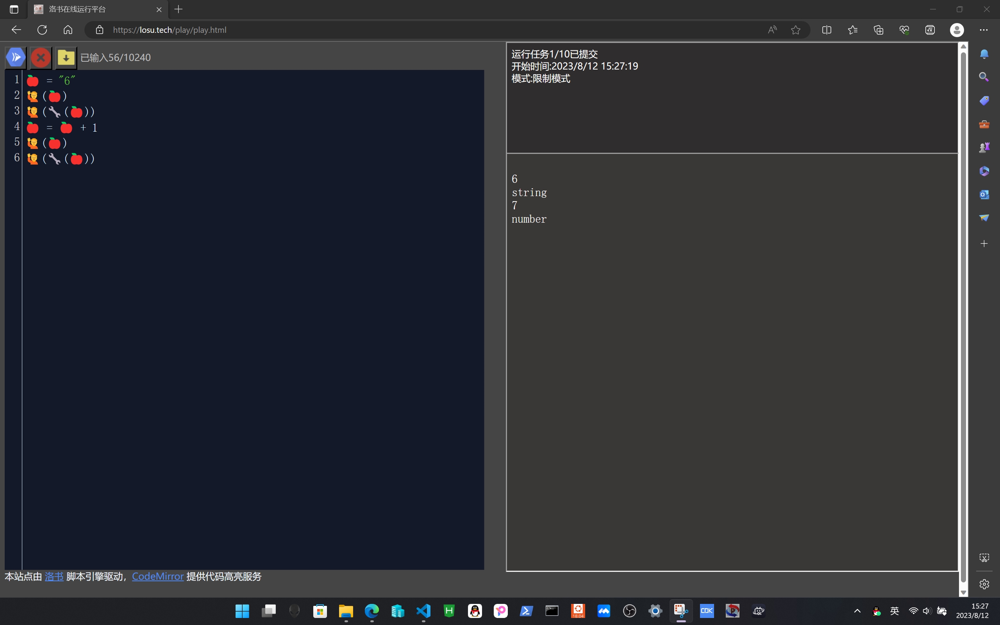
## 2.5.3-运算符
### 2.5.3.1-算数运算符
```python
数字运算(支持重载) + - * / ^
字符串拼接(支持重载) &
字符串截取 [] # 越界检查返回 '\0'
数组索引   []
成员访问   .
```
样例如下
```python
🍎 = "hello"
🍎 = 🍎 & "洛书"

🍌 = 1
🍌 = (🍌+1)^2

🙋(🍎)
🙋(🍎[1])
🙋(🍌)
```
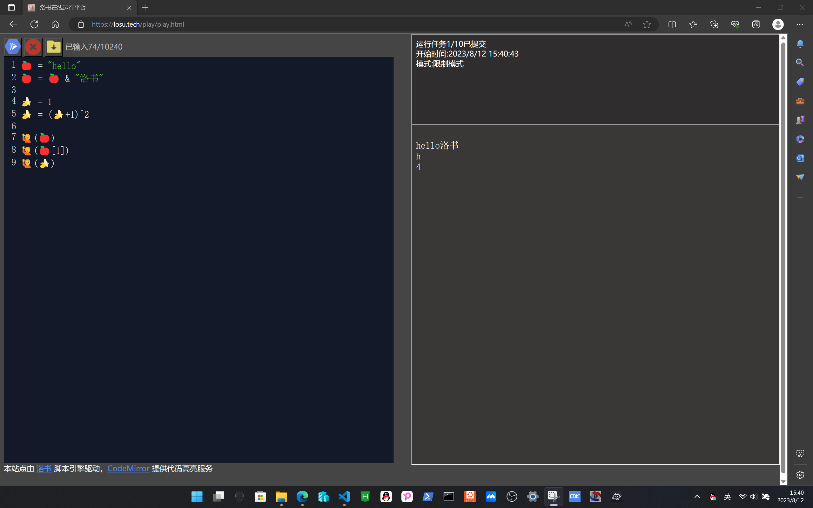
### 2.5.3.2-逻辑运算符
1. 洛书的运算符返回 null 表示不成立，返回非null 表示逻辑成立
2. 不同的运算符逻辑成立时返回的值不同
3. 逻辑运算符及其返回值如下

|运算符|成立条件|返回值|
|---|---|---|
|a == b|a与b相等|非null值|
|a != b|a与b不相同|非null值|
|a > b|a大于b，包括a的字符串模式"大于"b|非null值|
|a >= b|类推|非null值|
|a < b|类推|非null值|
|a <= b|类推|非null值|
| a \|\| b |等效于 or 关键词| 返回第一个非null对象的值或null |
|a && b|等效与 and 关键词|返回b，或第一个null对象|
|!a|等效于 not a|返回 非 a|

运行样例
```python
if 1=="1": 
    print("1:\t√")
;

if 1<2 : print("2:\t√") ;

if "abc"<"bcd": print("3:\t√") ;


print(a or 1)   # 1
a = 1           # a = 1
print(a or 2)   # 1


def func1(): print("func1") return 1 ;
def func2(): print("func2") return null ;
def func3(): print("func3") return 2 ;

a = func1() and func2() and func3()  # 运行到func2时就结束了，不会调用func3

```
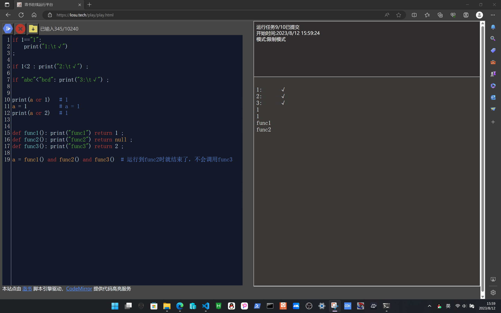


# 2.6-匿名函数与可变参数
## 2.6.1-匿名函数
上一节介绍了函数值的基本用法，既然函数可被视为值，那么，在洛书中，是否可以像声明基本类型字面量那样，以赋值的方式创建函数变量？答案是可以
```python
🐶 = def():
    print("汪汪汪")
;

🐶()
```


因此您也可以获得这种功能
```python
def 📢(指定函数):
    指定函数()  # 调用指定函数
;
📢(
    def():
        print('hello')
    ;
)

```
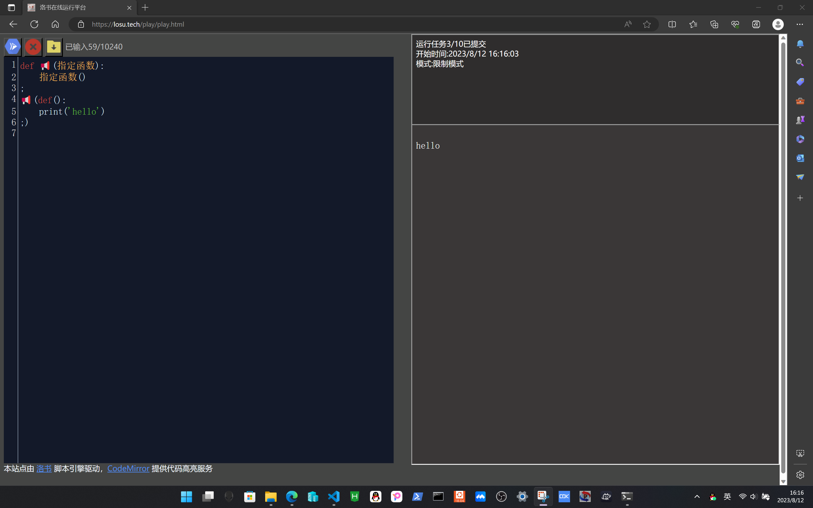

## 2.6.2-可变参数
洛书支持可变参数列表，您可以通过 arg/变参 数组获取可变参数
```python
def 🚂(火车名,...):
    🙋(火车名)
    for i=1,arg.n : # arg.n代表参数个数，等价于 变参.个数
        🙋("车厢"&i&"坐着"&变参[i])
    ;
;

🚂("K100",'Kate',"小明","李华")
```
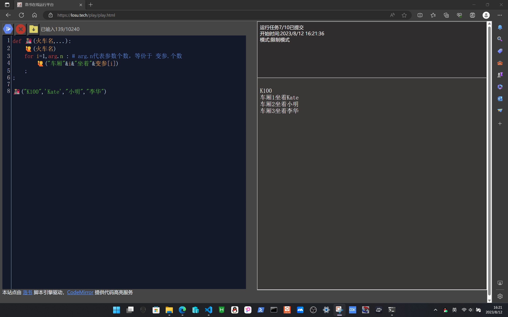

```
在部分模块中，洛书的可变参数机制可能会被关闭，请关注模块文档以获取替代方案
```


