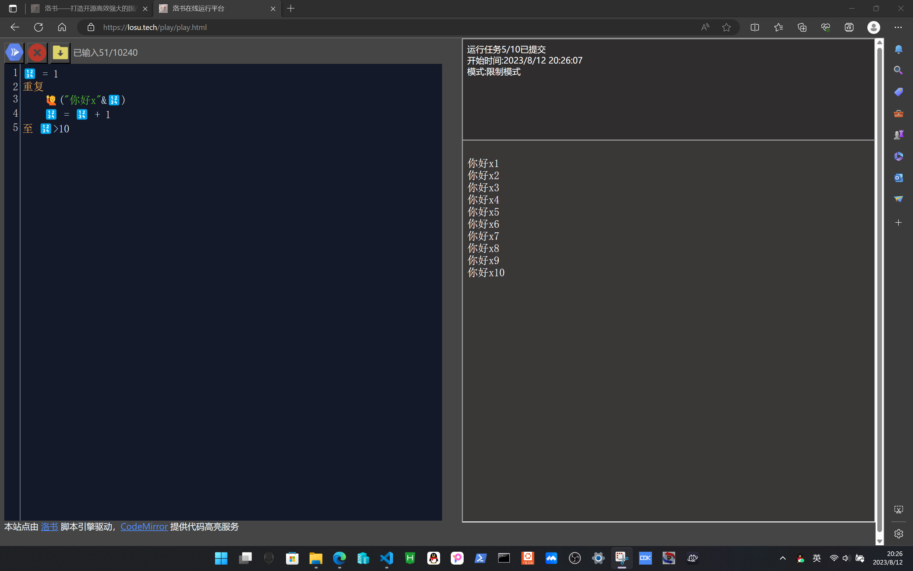
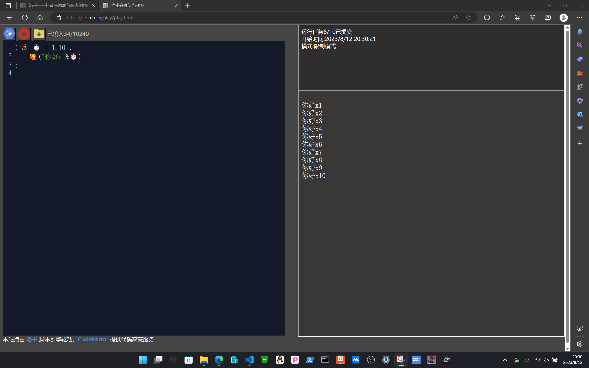
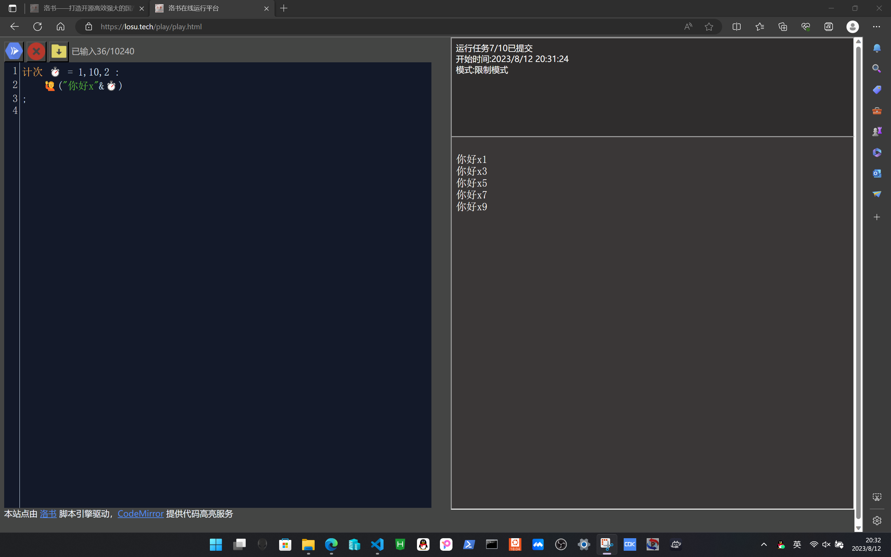
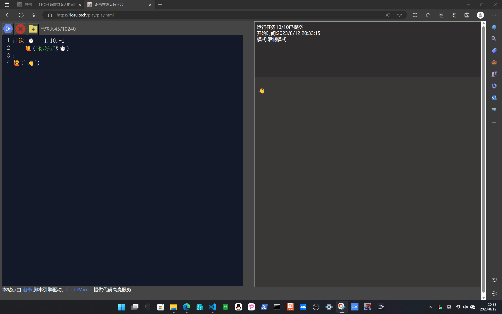
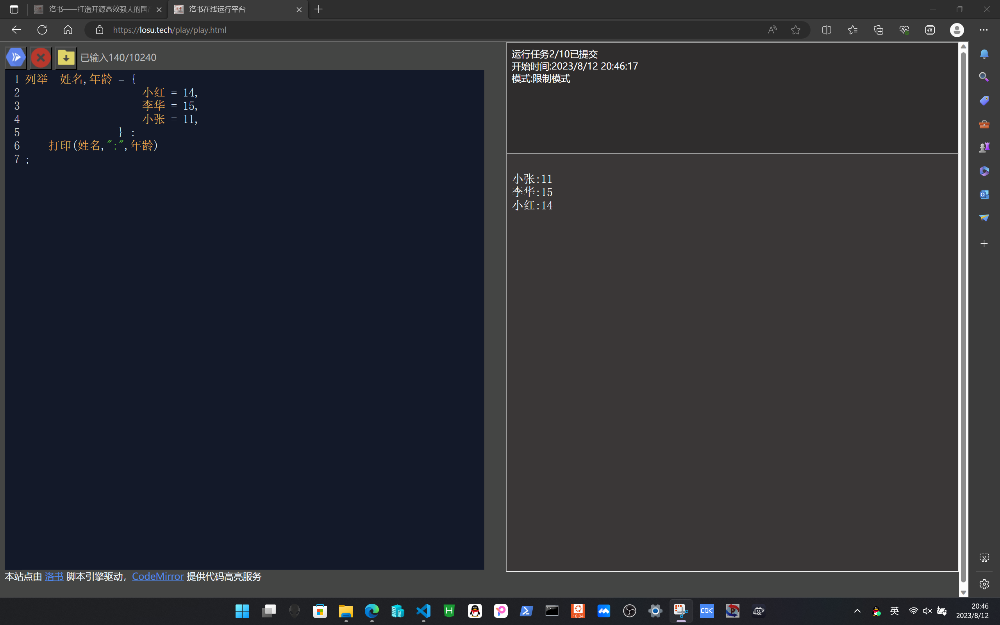
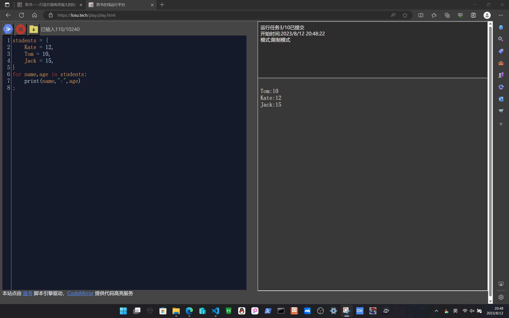
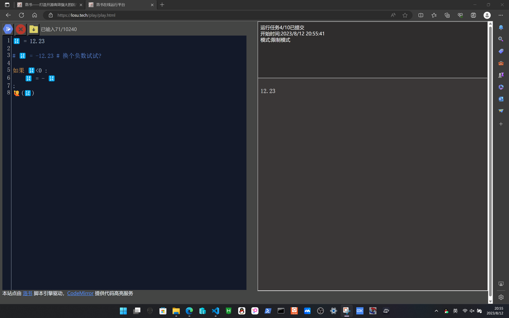

#!/bin/owls.wiki.losu.tech
# 3-语句
语句是程序设计中的重要部分，它起到操作程序走向的作用
洛书的语句主要分为
+ 循环语句
    - `当 ...` 型循环
    - `直到` 型循环
    - `计次` 型循环
    - `列举` 型循环
+ 条件语句
    - `if` 如果 型条件语句
    - `elif` 另外 型条件语句
    - `else` 否则 型条件语句

本章我们将详细讲解它们

# 3.1-循环语句(1)
` with / 当 ` 型循环语句是一种重要的循环语句，它的语法如下
```python

with [条件表达式] :
    # 语句内容
;

当 [条件表达式] :
    # 语句内容
;

```

它会首先判断条件表达式是否成立（即表达式的值不是 null ），如果成立，执行语句内容，然后重复至表达式不成立（值 为 null）

```python

🔢 = 1
with 🔢 <= 10 :
    🙋("你好x"&🔢)
    🔢 = 🔢 + 1 
;

```


# 3.2-循环语句(2)
` loop / 直到 ` 型循环语句是一种重要的循环语句，它的语法如下
```python

loop 
    # 语句内容
to [条件表达式] 

重复
    # 语句内容
至 [条件表达式]

```

它会先执行语句内容，判断条件表达式是否成立，如果成立，退出循环，如果不成立，重复前一过程

```python

🔢 = 1
重复
    🙋("你好x"&🔢)
    🔢 = 🔢 + 1 
至 🔢>10

```



# 3.3-循环语句(3)
` for 列举 ` 型循环语句是一种重要的循环语句，它的语法如下
```python
for 循环变量 = 起始值,最终值[,每次增加的数] : # []内代表可以省略
    # 循环语句
;

计次 循环变量 = 起始值,最终值[,每次增加的数] : # []内代表可以省略
    # 循环语句
;
```

它会逐步进行循环，直到循环变量变为目标值

```python
计次 ⏱️ = 1,10 :
    🙋("你好x"&⏱️)
;

```



```python
计次 ⏱️ = 1,10,2 :
    🙋("你好x"&⏱️)
;
```



如果计次条件永远不可能到达，洛书会直接跳过这个语句
```python
计次 ⏱️ = 1,10,-1 :
    🙋("你好x"&⏱️)
;
🙋('👋')
```


计次循环拥有以下宏变量，用来获取循环体的一些属性
```
变量名          作用
__MAX__         计次的目标次数
__STEP__        每次增加的步幅

__极值__        同 __MAX__
__步幅__        同 __STEP__

```

# 3.4-循环语句(4)
` for 列举 ` 型循环语句是一种重要的循环语句，它的语法如下
```python
for 脚标,值 =/in  被列举的对象 :
        # 循环语句
;

列举 脚标,值 =/in  被列举的对象 :
    # 循环语句
;
```

它会列举对象的每一个值，如果对象不存在，会引起报错
```python
列举  姓名,年龄 = {
                    小红 = 14,
                    李华 = 15,
                    小张 = 11,
                } :
    打印(姓名,":",年龄)
;
```


```python
students = {
    Kate = 12,
    Tom = 10,
    Jack = 15,
}
for name,age in students:
    print(name,":",age)
;
```



前文所讲的所有的循环语句，都可以使用 break 关键字提前跳出

# 3.5-条件语句
条件语句的语法如下，[]号内代表可以省略
```python
如果 条件1 :
    # 满足条件1，执行语句1
[另外 条件2:] 
    # 不满足条件1，满足条件2 执行语句2
[另外 条件3:] 
    # 不满足条件1与条件2，满足条件3 执行语句3
# 类推······     
否则
    # 不满足前面所有条件
;

```

以一个计算绝对值的程序为例
```python
🔢 = 12.23

# 🔢 = -12.23 # 换个负数试试?

如果 🔢<0 : 
    🔢 = - 🔢 
;
🙋(🔢)
```
