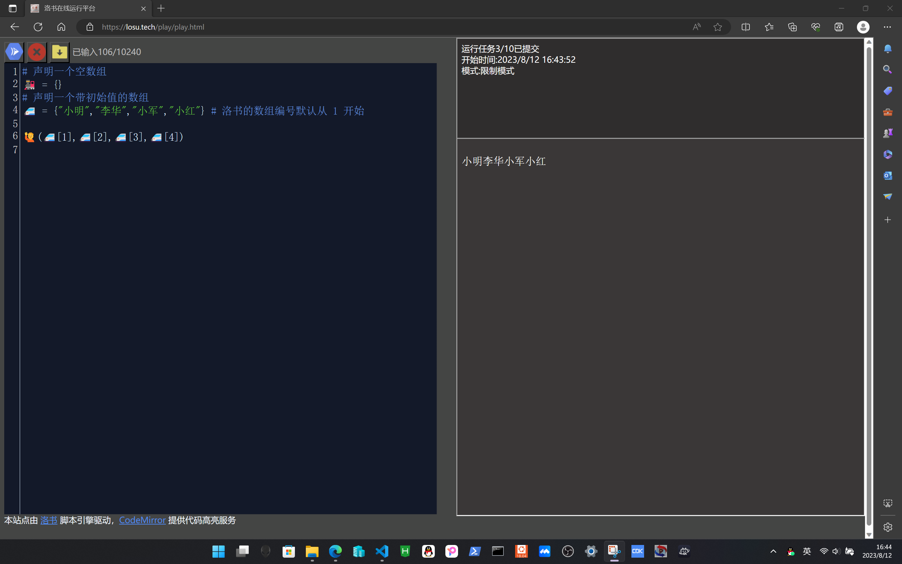
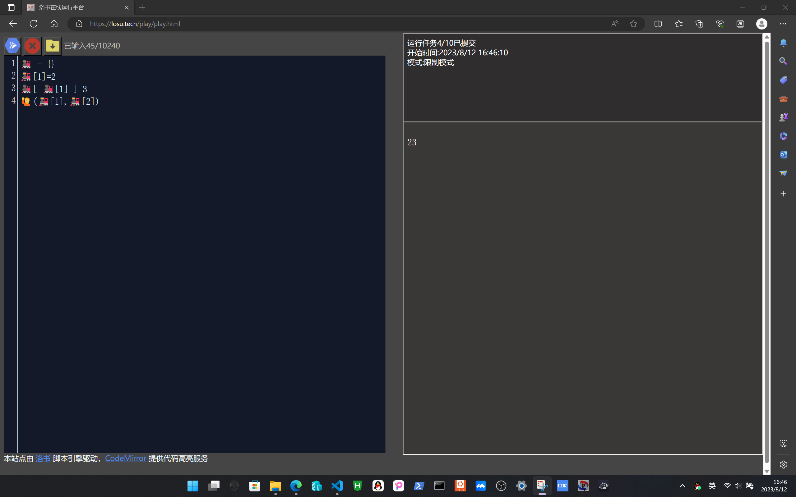
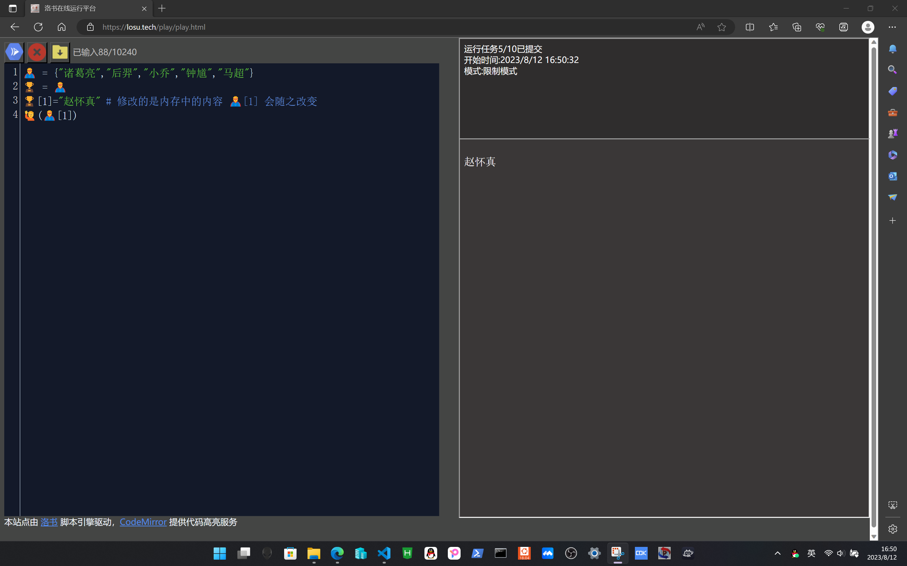
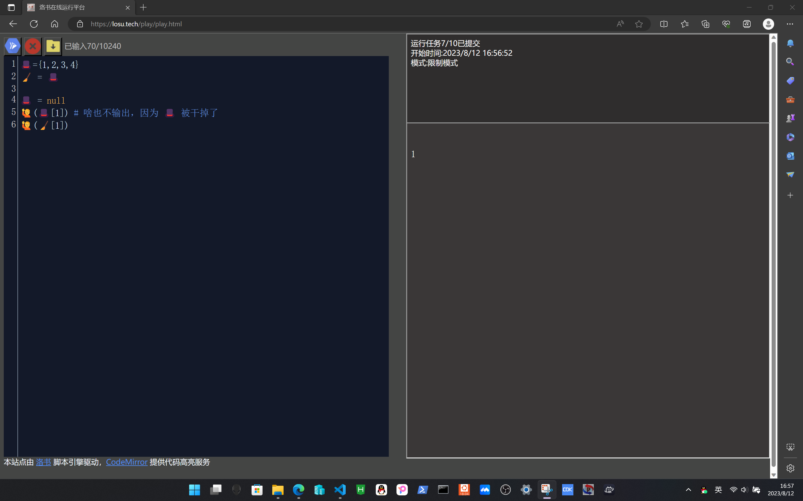
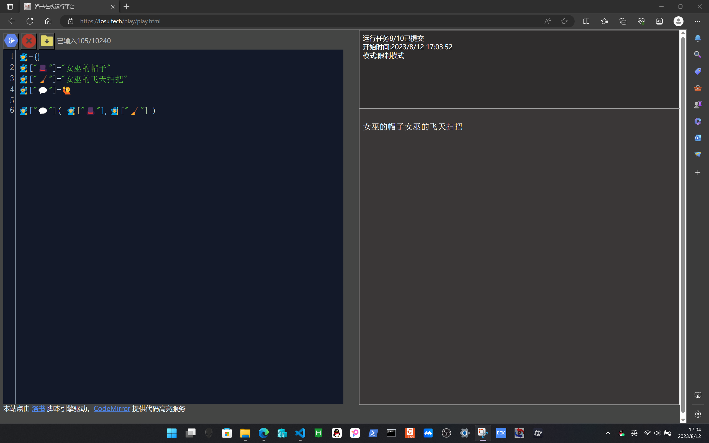

#!/bin/owls.wiki.losu.tech
# 4-数组
## 4.1-数组的模型
数组是一种特殊类型的变量，数组可以抽象为内存中的一段连续地址
## 4.2-数组的创建与使用
```python
# 声明一个空数组
🚂 = {}
# 声明一个带初始值的数组
🚅 = {"小明","李华","小军","小红"} # 洛书的数组编号默认从 1 开始

🙋(🚅[1],🚅[2],🚅[3],🚅[4])

```


您可以修改数组指定位置的内容
```python
🚂 = {}
🚂[1]=2
🚂[ 🚂[1] ]=3
🙋(🚂[1],🚂[2])

```


数组的本质是一段内存地址，修改数组中的内容本质是修改内存中对应的内容
```python
🦸 = {"诸葛亮","后羿","小乔","钟馗","马超"}
🏆 = 🦸 
🏆[1]="赵怀真" # 修改的是内存中的内容 🦸[1] 会随之改变
🙋(🦸[1])
```


## 4.3-数组的销毁
与销毁所有变量一样，直接赋值为 null，需要注意的是，一个变量名赋值为null并不会引起数组中内容的回收，只有在一个数组所有的变量名都被赋值null时，垃圾回收器才会回收这处空间

```
很像伏地魔的魂器，每一个变量名只是一个魂器，只有摧毁全部魂器才能干掉他
```

```python
🎩={1,2,3,4}
🧹 = 🎩

🎩 = null
🙋(🎩[1]) # 啥也不输出，因为 🎩 被干掉了
🙋(🧹[1])

```


## 4.4-特殊用法
洛书的数组脚标不局限于数字，也可以是其他数据类型
```python
🧙‍♀️={}
🧙‍♀️["🎩"]="女巫的帽子"
🧙‍♀️["🧹"]="女巫的飞天扫把"
🧙‍♀️["💬"]=🙋

🧙‍♀️["💬"](🧙‍♀️["🎩"],🧙‍♀️["🧹"])

```
