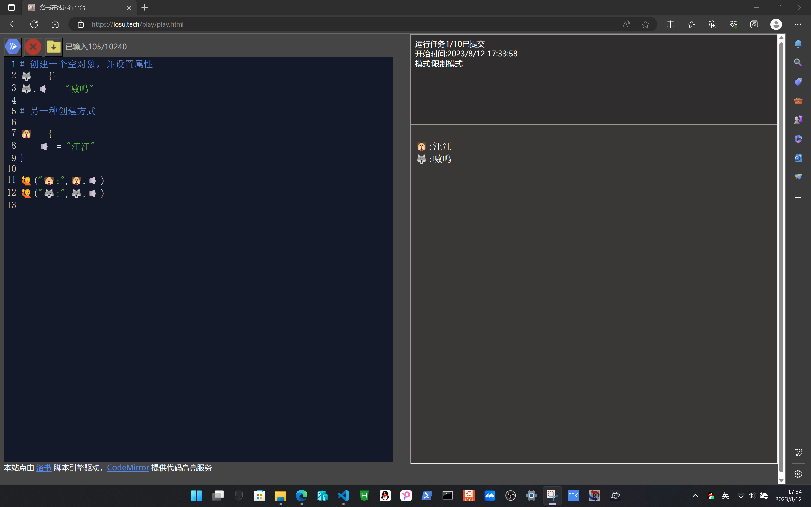
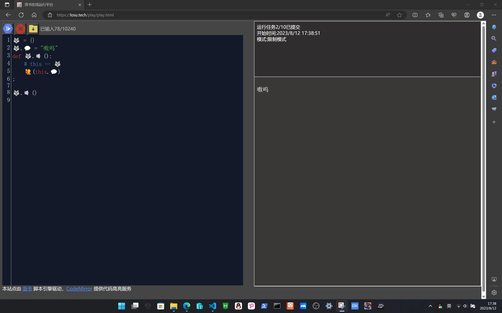
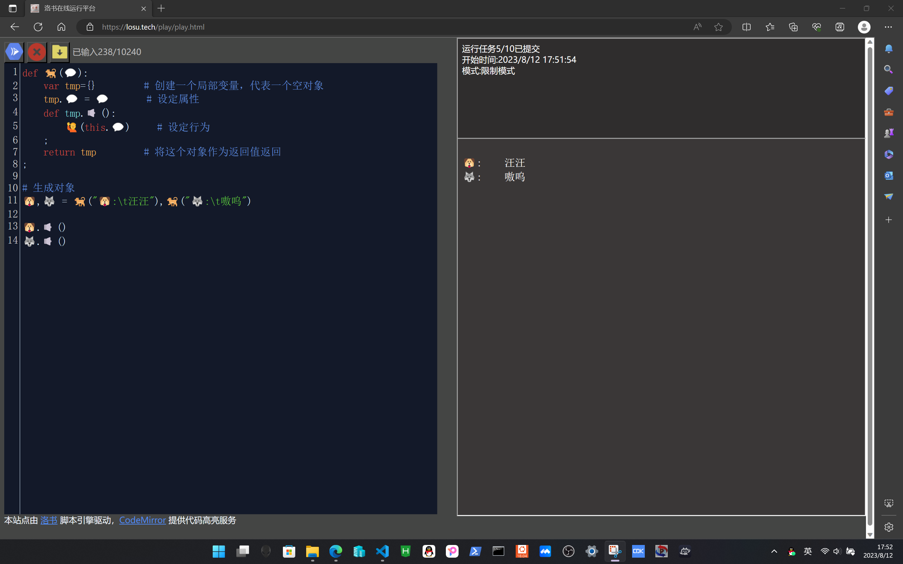
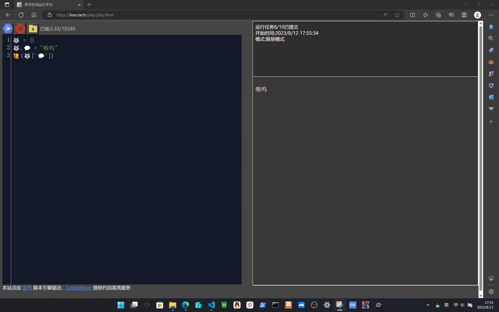
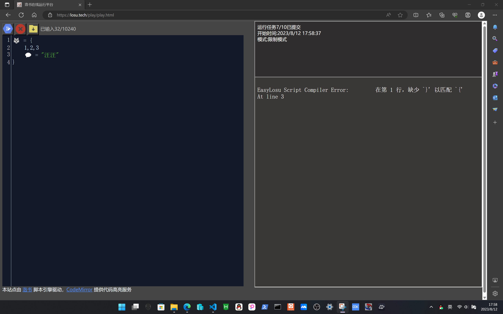
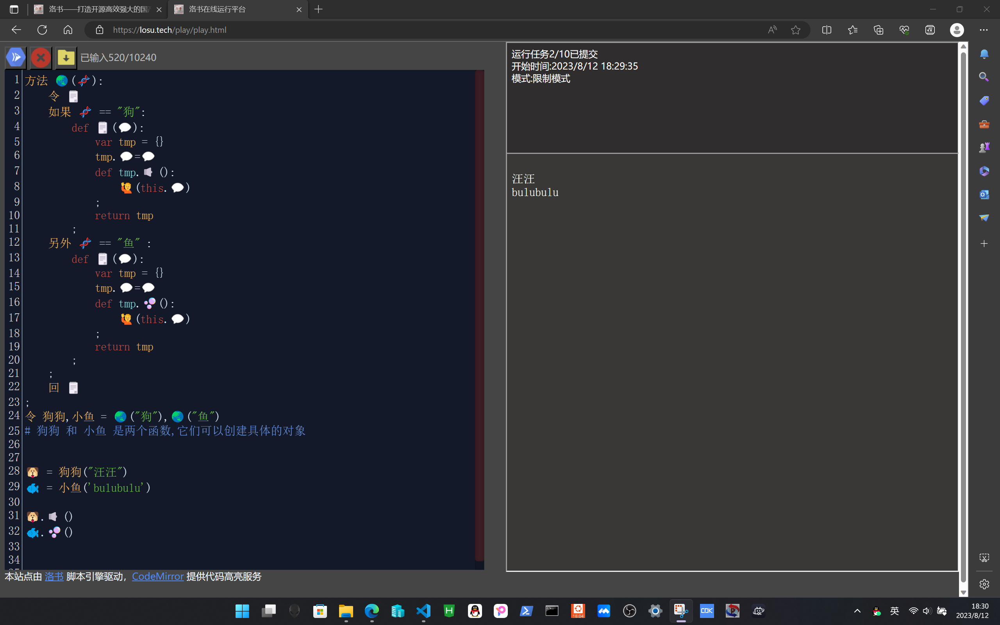

#!/bin/owls.wiki.losu.tech
# 5-对象
## 5.1-对象的模型
对象的本质与数组一样，也是一段特殊的内存地址，对象由属性与行为组成
## 5.2-对象的创建与使用
```python
# 创建一个空对象，并设置属性
🐺 = {}
🐺.🔈 = "嗷呜"

# 另一种创建方式
🐶 = {
    🔈 = "汪汪",   
}

🙋("🐶:",🐶.🔈)
🙋("🐺:",🐺.🔈)

```


## 5.3-成员函数与this指针
成员函数决定了一个对象的行为，当我们声明/调用成员函数时，洛书会为其添加指向当前对象的this指针

```python
🐺 = {}
🐺.💬 = "嗷呜"
def 🐺.🔈():
    # this == 🐺
    🙋(this.💬)
;

🐺.🔈()

```


## 5.4-匿名函数与this指针
当成员函数被隐式调用，或者以匿名函数的形式被赋值时，洛书不会自动处理this指针，需要用户手动处理

```python
🐺 = {}
🐺.💬 = "嗷呜"
🐺.🔈=def(this): # 匿名函数
    # this == 🐺
    🙋(this.💬)
;
🐕 = 🐺.🔈

🐺.🔈()     # 显式调用，自动传this
🐕(🐺)      # 隐式调用，手动传this 
```


## 5.5-用函数生成对象
我们可以将利用函数，动态地生成不同对象，实现面向对象编程

```python
def 🐕(💬):
    var tmp={}         # 创建一个局部变量，代表一个空对象
    tmp.💬 = 💬       # 设定属性
    def tmp.🔈():
        🙋(this.💬)     # 设定行为
    ;
    return tmp         # 将这个对象作为返回值返回
;

# 生成对象
🐶,🐺 = 🐕("🐶:\t汪汪"),🐕("🐺:\t嗷呜")

🐶.🔈()
🐺.🔈()

```


## 5.6 对象与数组
对象与数组是unit类型的两种表现形式，其在一定程度上可以通用，`对象.属性`与`对象["属性"]`会访问同一片内存地址

```python
🐺 = {}
🐺.💬 = "嗷呜"
🙋(🐺['💬'])
```


虽然洛书允许在运行时将对象与数组进行通用，但是，在声明时是不可以混合声明的，比如下面的写法就是一个错误的样例
```python
🐺 = {
    1,2,3
    💬 = "汪汪"
}
```


## 5.7-嵌套对象
对象中的某一属性也可以是对象，在这种情况下，我们称之为嵌套对象。
```python
方法 🌏(🧬):
    令 🗒️ 
    如果 🧬 == "狗":
        def 🗒️(💬):
            var tmp = {}
            tmp.💬=💬
            def tmp.🔈():
            	🙋(this.💬)	
            ;
            return tmp
        ;
    另外 🧬 == "鱼" :
    	def 🗒️(💬):
            var tmp = {}
            tmp.💬=💬
            def tmp.🫧():
            	🙋(this.💬)	
            ;
            return tmp
        ;
    ;
    回 🗒️ 
;
令 狗狗,小鱼 = 🌏("狗"),🌏("鱼") 
# 狗狗 和 小鱼 是两个函数,它们可以创建具体的对象
 

🐶 = 狗狗("汪汪")
🐟 = 小鱼('bulubulu')

🐶.🔈()
🐟.🫧()

```



