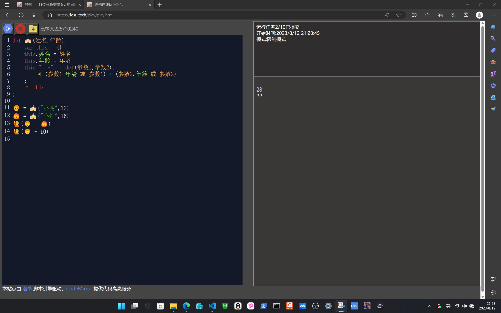

#!/bin/owls.wiki.losu.tech
# 6-运算符重载
让我假设一种场景，我们有两个学生对象，他们有一个共同的属性 年龄，我们想对他们的年龄求和，通常，我们可以这样写
```python
def 🏫(姓名,年龄):
    var this = {}
    this.姓名 = 姓名
    this.年龄 = 年龄
    回 this
;
👦 = 🏫("小明",12)
👩‍🦰 = 🏫("小红",16)
🙋((👦.年龄+👩‍🦰.年龄))

```

我们可以采用更简单的方式

```python
def 🏫(姓名,年龄):
    var this = {}
    this.姓名 = 姓名
    this.年龄 = 年龄
    this["::+"] = def(参数1,参数2):
        回 (参数1.年龄 或 参数1) + (参数2.年龄 或 参数2)
    ;
    回 this
;

👦 = 🏫("小明",12)
👩‍🦰 = 🏫("小红",16)
🙋(👦 + 👩‍🦰)
🙋(👦 + 10)
```



洛书支持重载的运算符有```+ - * /  ^ & ```