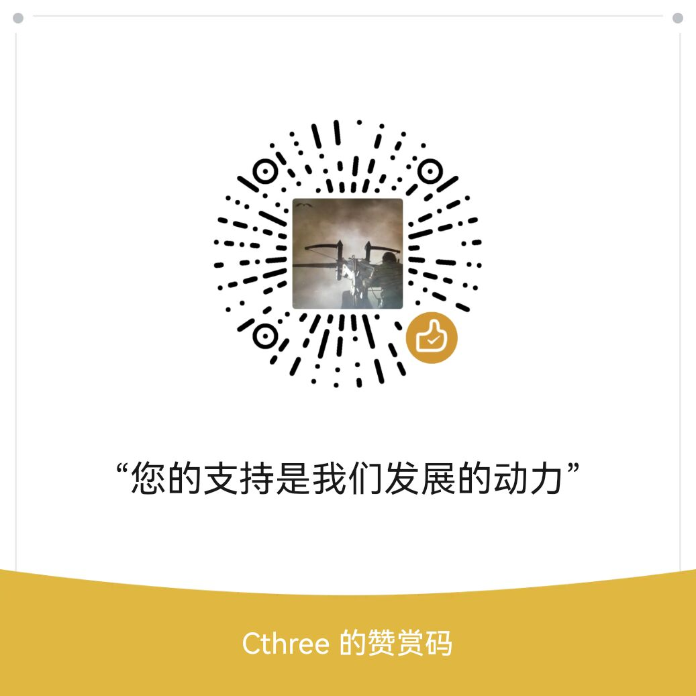

#!/bin/owls.wiki.losu.tech

# 欢迎 

+ 欢迎来到洛书文档中心！
+ 本站基于 [OWLS](./owls.md) Wiki 工具构建
+ 洛书是一个遵循 [MIT LICENSE](./LICENSE.md) 的开源软件。 

# 本站提供哪些文档？

## 1 - 入门指南

+ [1-1-在线服务](./1-1-在线服务.md)
+ [1-2-下载与安装](./1-2-下载与安装.md)
+ [1-3-初识模块管理器](./1-3-初识模块管理器.md)

## 2 - 语法手册
+ [2-1-你好洛书.md](./2-1-你好洛书.md)         
+ [2-2-程序结构.md](./2-2-程序结构.md)
+ [2-3-语句.md](./2-3-语句.md)
+ [2-4-数组.md](./2-4-数组.md)            
+ [2-5-对象.md](./2-5-对象.md)
+ [2-6-运算符重载.md](./2-6-运算符重载.md)
+ [2-7-构造函数.md](./2-7-构造函数.md)
+ [2-8-转义字符](./2-8-转义字符.md)

## 3 - 开发环境与工具链
+ [3-1-模块化与工程管理](./3-1-模块化与工程管理.md)
+ [3-2-模块管理器的进阶](./3-2-模块管理器的进阶.md)
+ [3-3-创建一个模块工程](./3-3-创建一个模块工程.md)
+ [3-4-模块工具的使用](./3-4-模块工具的使用.md)

## 4 - 内核与模块开发
+ 4-1-内核原理
    - B站专栏
+ [4-2-内核的移植](./4-2-内核的移植.md)
+ 4-3-配置和高级功能
    - 4-3-1-内存管理器
    - 4-3-2-垃圾回收器
    - 4-3-3-虚拟机堆栈
    - 4-3-4-多线程模型与锁
    - 4-3-5-协程与并发
+ 4-4-虚拟机API参考
    - [4-4-1-虚拟机对象-els_VmObj](./4-4-1-虚拟机对象-els_VmObj.md)
    - [4-4-2-洛书对象-LosuObj](./4-4-2-洛书对象-LosuObj.md)
    - [4-4-3-参数传递](./4-4-3-参数传递.md)

## 5 - 社区与贡献

<section id="contribute" style=""></section>

+ 5-1-洛书社区
    + [5-1-1-了解洛书社区](./5-1-1-了解洛书社区.md)
    + [5-1-2-版本发布与维护](./5-1-2-版本发布规则.md)
    + [5-1-3-交流与合作](./5-1-3-交流与合作.md)
    
+ 5-2-贡献指南
    + [5-2-1-贡献原则](./5-2-1-贡献原则.md)
    + 5-2-2-贡献代码
        - [5-2-2-1-贡献模块](./5-2-2-1-贡献模块.md)
        <!-- - [5-2-2-2-适配与移植](./5-2-2-2-适配与移植.md) -->
        - 5-2-2-2-适配与移植
        <!-- - [5-2-2-3-贡献内核](./5-2-2-3-贡献内核.md) -->
        - 5-2-2-3-贡献内核
    + 5-2-3-并不是只有代码才算贡献，您也可以
        - 参与洛书社区的开源活动
        - 在公司产品、个人项目或比赛中使用洛书
        - 向我们反馈问题，提交 issue
        - 捐赠项目 

            

## 6-专栏教程

## 7-活动回顾

# 附录 - 相关资源
+ [洛书在线服务中心](https://losu.tech/studio/)
+ [洛书在线运行平台](https://losu.tech/playground/)
+ [洛书代码源](https://losu.tech/archive/)
+ [下载中心](https://losu.tech/archive/lasted/.repo/release/)
+ [开源仓库](https://gitee.com/chen-chaochen/lpk)

# 版权
+ 洛书是一个由个人发起的开源项目，作者是[@chen-chaochen](https://gitee.com/chen-chaochen)，并基于 MIT LICENSE 分发
+ 加入 [PLOC](https://gitee.com/ploc-org) 社区，一起参与国产编程语言共建之路

