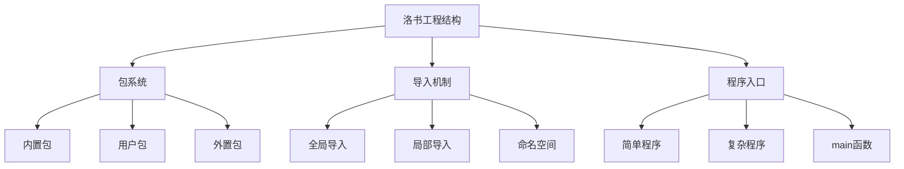

# 5. 工程结构

洛书语言提供了灵活而强大的工程结构管理机制，包括包与导入系统和程序入口定义。本章将详细介绍如何组织和管理洛书项目的结构。

## 本章内容

- [包与导入](包与导入.md) - 模块化编程和代码复用
- [程序入口](程序入口.md) - 程序的启动和执行机制

## 洛书工程结构概览

洛书的工程结构设计遵循现代编程语言的最佳实践，支持模块化开发和代码复用：



## 包系统设计理念

洛书的包系统基于以下设计理念：

### 1. 目录即包

在洛书中，包是以目录的形式存在的，每个包目录必须包含一个 `main.losu` 文件作为入口点：

```
myproject/
├── main.losu          # 程序入口
├── utils/             # 工具包
│   ├── main.losu      # 包入口
│   ├── string.losu    # 字符串工具
│   └── math.losu      # 数学工具
├── models/            # 数据模型包
│   ├── main.losu      # 包入口
│   ├── user.losu      # 用户模型
│   └── product.losu   # 产品模型
└── lib/               # 第三方库
    └── external/
        └── main.losu
```

### 2. 显式导出

包必须通过 `return{}` 语句显式导出其接口：

```losu
# utils/main.losu
import std

# 导入包内的其他模块
let stringUtils = !import('./string')
let mathUtils = !import('./math')

# 显式导出包接口
return {
    string: stringUtils,
    math: mathUtils,
    version: '1.0.0'
}
```

### 3. 分层导入

洛书支持两种导入方式：

- **全局导入** (`import`)：用于内置包，导入到全局命名空间
- **局部导入** (`std::!import`)：用于用户包和外置包，返回包对象

```losu
# 全局导入内置包
import std
import os
import fs

# 局部导入用户包
let utils = std::!import('utils')
let models = std::!import('models')

# 局部导入外置包（使用@前缀）
let externalLib = std::!import('@external-package')
```

## 包的类型

### 内置包

内置包是洛书语言自带的标准库包，可以直接使用 `import` 语句导入：

```losu
import std    # 标准库
import os     # 操作系统接口
import fs     # 文件系统
import math   # 数学库
import time   # 时间处理
import cstr   # 字符串处理

main {
    println('使用内置包')
    println('当前时间:', time::now())
    println('数学常数π:', math::PI)
}
```

### 用户包

用户包是项目中自定义的包，需要使用 `std::!import` 导入：

```losu
# 创建用户包 myutils/main.losu
import std

def formatNumber(num) {
    return 'Number: ' & num
}

def formatString(str) {
    return 'String: "' & str & '"'
}

return {
    formatNumber: formatNumber,
    formatString: formatString
}
```

```losu
# 使用用户包
import std

let myutils = std::!import('myutils')

main {
    println(myutils.formatNumber(42))
    println(myutils.formatString('hello'))
}
```

### 外置包

外置包是第三方提供的包，使用 `@` 前缀标识：

```losu
import std

# 导入外置包
let httpClient = std::!import('@http-client')
let jsonParser = std::!import('@json-parser')

main {
    let response = httpClient.get('https://api.example.com/data')
    let data = jsonParser.parse(response.body)
    println('获取到数据:', data)
}
```

## 命名空间管理

洛书提供了 `namespace` 函数来管理命名空间：

```losu
import std

# 导入包到命名空间
let mathLib = std::!import('math-extended')
namespace(mathLib)

# 导入多个包
let utils = std::!import('utils')
let helpers = std::!import('helpers')

# 将多个包合并到命名空间
namespace(utils)
namespace(helpers)

main {
    # 现在可以直接使用包中的函数
    let result = advancedCalculation(10, 20)  # 来自mathLib
    let formatted = formatResult(result)      # 来自utils或helpers
    println(formatted)
}
```

## 包的版本管理

虽然洛书本身不强制版本管理，但推荐在包中包含版本信息：

```losu
# mypackage/main.losu
import std

return {
    version: '2.1.0',
    author: 'Your Name',
    description: 'A useful package',

    # 包的功能
    functions: {
        doSomething: doSomething,
        doSomethingElse: doSomethingElse
    },

    # 包的常量
    constants: {
        MAX_SIZE: 1000,
        DEFAULT_TIMEOUT: 30
    }
}

def doSomething() {
    return 'something done'
}

def doSomethingElse() {
    return 'something else done'
}
```

## 循环依赖处理

洛书会自动检测和处理循环依赖，但建议避免循环依赖的设计：

```losu
# ❌ 避免循环依赖
# packageA 依赖 packageB
# packageB 依赖 packageA

# ✅ 推荐的依赖结构
# 使用共同的基础包
# packageA 和 packageB 都依赖 common
# 或者重新设计包的职责分离
```

## 最佳实践

### 1. 包的组织原则

```losu
# ✅ 按功能组织包
project/
├── auth/          # 认证相关
├── database/      # 数据库操作
├── api/           # API接口
├── utils/         # 通用工具
└── models/        # 数据模型

# ✅ 清晰的包接口
# package/main.losu
return {
    # 公开接口
    publicFunction1: publicFunction1,
    publicFunction2: publicFunction2,

    # 常量
    CONSTANTS: {
        MAX_RETRY: 3,
        TIMEOUT: 5000
    }

    # 不导出私有函数
    # privateFunction 不在这里
}
```

### 2. 导入的最佳实践

```losu
import std

# ✅ 在文件顶部集中导入
import os
import fs

let utils = std::!import('utils')
let config = std::!import('config')

# ✅ 使用有意义的变量名
let httpClient = std::!import('http-client')
let jsonParser = std::!import('json-parser')

# ❌ 避免在函数内部导入（除非必要）
def someFunction() {
    # let localImport = std::!import('something')  # 不推荐
}
```

### 3. 程序入口的选择

```losu
# ✅ 简单脚本 - 直接执行
import std
println('Hello World')

# ✅ 应用程序 - 使用main块
import std

def setupApplication() {
    # 初始化代码
}

main {
    setupApplication()
    # 主程序逻辑
}

# ✅ 库包 - 使用return导出
import std

def libraryFunction() {
    # 库函数
}

return {
    libraryFunction: libraryFunction
}
```

## 学习路径建议

> [!TIP]
> **初学者**：建议先学习简单的导入和程序入口，然后逐步了解包的创建和管理。重点掌握内置包的使用和简单用户包的创建。

> [!NOTE]
> **有经验的程序员**：可以重点关注洛书独特的包系统设计，特别是全局导入vs局部导入的区别，以及main块的使用场景。

## 本章学习目标

学完本章后，您将能够：

- ✅ 理解洛书的包系统设计理念
- ✅ 正确使用内置包、用户包和外置包
- ✅ 掌握全局导入和局部导入的区别
- ✅ 创建和管理自己的包
- ✅ 选择合适的程序入口方式
- ✅ 使用命名空间管理功能
- ✅ 组织大型项目的代码结构
- ✅ 避免常见的依赖问题

---
**上一章**：[← 基本操作](../4-并发编程/基本操作.md) |
**下一章**：[包与导入 →](包与导入.md)