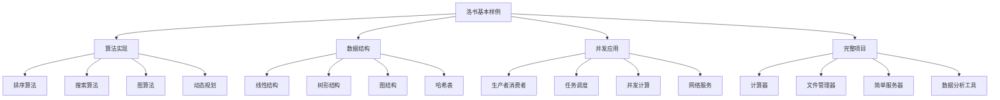

# 6. 基本样例

本章通过一系列完整的算法题和应用示例，展示洛书语言的语法特性和编程技巧。这些样例涵盖了数据结构、算法、并发编程、工程结构等各个方面，帮助您全面掌握洛书编程。

## 本章内容

- [算法实现](algorithms.md) - 经典算法的洛书实现
- [数据结构](data-structures.md) - 常用数据结构的实现
- [并发应用](concurrent-apps.md) - 并发编程的实际应用
- [完整项目](complete-projects.md) - 综合性的项目示例

## 样例特色

本章的样例具有以下特色：



## 学习建议

### 渐进式学习

建议按以下顺序学习本章内容：

1. **算法实现** - 掌握基本的算法思维和洛书语法运用
2. **数据结构** - 理解数据组织和洛书的面向对象特性
3. **并发应用** - 学习洛书独特的并发编程模型
4. **完整项目** - 综合运用所学知识构建实际应用

### 实践导向

每个样例都包含：

- **完整的代码实现**
- **详细的注释说明**
- **运行结果展示**
- **扩展思考题**

## 样例概览

### 经典算法

本章包含以下经典算法的洛书实现：

```losu
import std

# 快速排序示例
def quickSort(arr, low, high) {
    if (low < high) {
        let pi = partition(arr, low, high)
        quickSort(arr, low, pi - 1)
        quickSort(arr, pi + 1, high)
    }
}

def partition(arr, low, high) {
    let pivot = arr[high]
    let i = low - 1

    for (j in low, high - 1) {
        if (arr[j] <= pivot) {
            i = i + 1
            swap(arr, i, j)
        }
    }

    swap(arr, i + 1, high)
    return i + 1
}

def swap(arr, i, j) {
    let temp = arr[i]
    arr[i] = arr[j]
    arr[j] = temp
}

# 演示快速排序
main {
    let data = [64, 34, 25, 12, 22, 11, 90]
    println('原数组:', data)

    quickSort(data, 0, sizeof(data) - 1)
    println('排序后:', data)
}
```

### 数据结构实现

展示如何用洛书实现常用数据结构：

```losu
import std

# 链表实现示例
class ListNode {
    def __init__(value) {
        self.value = value
        self.next = false
    }
}

class LinkedList {
    def __init__() {
        self.head = false
        self.size = 0
    }

    def append(value) {
        let newNode = ListNode(value)

        if (not self.head) {
            self.head = newNode
        } else {
            let current = self.head
            while (current.next) {
                current = current.next
            }
            current.next = newNode
        }

        self.size = self.size + 1
    }

    def display() {
        let result = []
        let current = self.head

        while (current) {
            result = result & [current.value]
            current = current.next
        }

        return result
    }
}

# 演示链表使用
main {
    let list = LinkedList()

    list.append(1)
    list.append(2)
    list.append(3)

    println('链表内容:', list.display())
    println('链表大小:', list.size)
}
```

### 并发编程应用

展示洛书并发编程的实际应用：

```losu
import std

# 并发计算示例
def parallelSum(data, numThreads) {
    let chunkSize = sizeof(data) / numThreads
    let threads = []
    let results = []

    for (i in 0, numThreads - 1) {
        let start = i * chunkSize
        let end = if (i == numThreads - 1) {
            sizeof(data) - 1
        } else {
            (i + 1) * chunkSize - 1
        }

        let thread = async(true) {
            let sum = 0
            for (j in start, end) {
                sum = sum + data[j]
            }
            return sum
        }

        threads = threads & [thread]
    }

    # 收集结果
    let totalSum = 0
    for (thread in threads) {
        let partialSum = await(thread)
        totalSum = totalSum + partialSum
    }

    return totalSum
}

# 演示并发计算
main {
    let largeArray = []
    for (i in 1, 1000) {
        largeArray = largeArray & [i]
    }

    println('数组大小:', sizeof(largeArray))

    let result = parallelSum(largeArray, 4)
    println('并发计算结果:', result)

    # 验证结果
    let expected = (1000 * 1001) / 2
    println('期望结果:', expected)
    println('计算正确:', result == expected)
}
```

## 代码风格指南

本章的所有样例都遵循以下代码风格：

### 1. 命名规范

```losu
# ✅ 变量和函数：小驼峰或下划线
let userName = 'Alice'
let user_count = 10

def calculateSum(numbers) { ... }
def process_data(input) { ... }

# ✅ 类名：大驼峰
class BinaryTree { ... }
class HttpServer { ... }

# ✅ 常量：全大写下划线
global MAX_SIZE = 1000
global DEFAULT_TIMEOUT = 30
```

### 2. 注释规范

```losu
import std

# 函数功能说明
def binarySearch(arr, target) {
    let left = 0
    let right = sizeof(arr) - 1

    while (left <= right) {
        let mid = (left + right) / 2  # 计算中点

        if (arr[mid] == target) {
            return mid  # 找到目标，返回索引
        } elif (arr[mid] < target) {
            left = mid + 1  # 在右半部分搜索
        } else {
            right = mid - 1  # 在左半部分搜索
        }
    }

    return -1  # 未找到目标
}
```

### 3. 错误处理

```losu
import std

def safeOperation(input) {
    except error {
        # 验证输入
        if (not input) {
            raise '输入不能为空'
        }

        # 执行操作
        let result = processInput(input)
        return true, result

    } {
        # 错误处理
        println('操作失败:', error)
        return false, error
    }
}

def processInput(input) {
    return input & '_processed'
}
```

## 性能考虑

样例中包含了性能优化的考虑：

### 1. 算法复杂度

每个算法都标注了时间和空间复杂度：

```losu
# 快速排序
# 时间复杂度：平均 O(n log n)，最坏 O(n²)
# 空间复杂度：O(log n)
def quickSort(arr, low, high) {
    # 实现...
}

# 二分搜索
# 时间复杂度：O(log n)
# 空间复杂度：O(1)
def binarySearch(arr, target) {
    # 实现...
}
```

### 2. 内存使用

```losu
# ✅ 内存友好的实现
def efficientProcess(data) {
    # 原地操作，不创建额外数组
    for (i in 0, sizeof(data) - 1) {
        data[i] = data[i] * 2
    }
    return data
}

# ❌ 内存消耗大的实现
def inefficientProcess(data) {
    let result = []
    for (item in data) {
        result = result & [item * 2]  # 每次都创建新数组
    }
    return result
}
```

### 3. 并发优化

```losu
# 合理的并发粒度
def parallelProcess(data, numThreads) {
    # 确保每个线程有足够的工作量
    let minChunkSize = 100
    let actualThreads = min(numThreads, sizeof(data) / minChunkSize)

    # 实现并发处理...
}

def min(a, b) {
    return if (a < b) { a } else { b }
}
```

## 学习路径建议

> [!TIP]
> **初学者**：建议从简单的算法开始，逐步学习复杂的数据结构和并发应用。每个样例都要亲自运行和修改，加深理解。

> [!NOTE]
> **有经验的程序员**：可以重点关注洛书特有的语法特性在算法实现中的应用，以及并发编程模型的优势。

## 本章学习目标

学完本章后，您将能够：

- ✅ 使用洛书实现经典算法
- ✅ 构建常用的数据结构
- ✅ 编写高效的并发程序
- ✅ 开发完整的应用项目
- ✅ 遵循良好的代码风格
- ✅ 进行性能优化
- ✅ 处理复杂的编程问题
- ✅ 独立设计和实现洛书程序

---

**下一步**：[算法实现 →](algorithms.md)