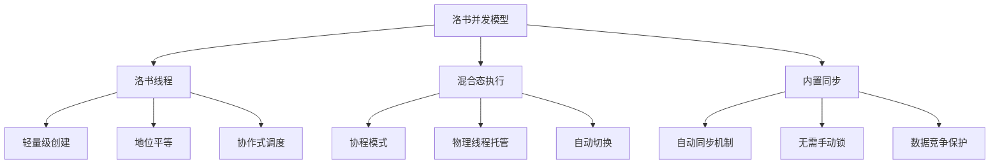

# 4. 并发编程

洛书语言内置了强大的并发编程支持，通过洛书线程（losu thread）提供了轻量级的并发执行能力。本章将详细介绍洛书的并发编程模型和相关操作。

## 本章内容

- [洛书线程](losu-thread.md) - 洛书线程的概念和特性
- [基本操作](basic-operations.md) - 创建、让出、取消、等待、休眠、同步

## 洛书并发模型概览

洛书采用了独特的混合态线程模型，结合了协程的轻量级特性和线程的并行能力：



## 洛书线程特性

### 1. 轻量级和高效

洛书线程比传统操作系统线程更轻量级，创建和切换开销很小：

```losu
import std

main {
    println('主线程开始')

    # 创建多个轻量级线程
    for (i in 1,5) {
        async(true) {
            println('线程', i, '执行')
            yield  # 让出执行权
            println('线程', i, '继续执行')
        }
    }

    println('主线程结束')
}
```

### 2. 地位平等

所有洛书线程都是地位平等的，没有主线程和子线程的概念：

```losu
import std

main {
    let t1 = async(true) {
        println('线程1开始')
        yield
        println('线程1结束')
    }

    let t2 = async(true) {
        println('线程2开始')
        yield
        println('线程2结束')
    }

    println('主函数执行')
    yield
    println('主函数继续')
}
```

### 3. 协作式调度

洛书线程采用协作式调度，线程需要主动让出执行权：

```losu
import std

main {
    async(true) {
        for (i in 1,3) {
            println('工作线程:', i)
            yield  # 主动让出
        }
    }

    for (i in 1,3) {
        println('主线程:', i)
        yield  # 主动让出
    }
}
```

## 内置同步机制

洛书语言的一个重要特性是内置了同步机制，无需手动使用锁：

```losu
import std

main {
    global let counter = 0

    # 多个线程同时修改全局变量
    let t1 = async(true) {
        for (i in 1,5) {
            counter = counter + 1
            println('线程1: counter =', counter)
            yield
        }
    }

    let t2 = async(true) {
        for (i in 1,5) {
            counter = counter + 1
            println('线程2: counter =', counter)
            yield
        }
    }

    # 等待所有线程完成
    await(t1)
    await(t2)

    println('最终 counter =', counter)  # 应该是10
}
```

## 并发编程最佳实践

### 1. 合理使用yield

```losu
import std

main {
    # ✅ 好的实践：在适当的地方让出
    async(true) {
        for (i in 1,100) {
            # 执行一些工作
            let result = i * i

            # 每10次迭代让出一次
            if (i % 10 == 0) {
                yield
            }
        }
    }

    # ❌ 避免：从不让出（可能导致其他线程饿死）
    # async(true) {
    #     while (true) {
    #         # 大量计算，从不yield
    #     }
    # }

    # ❌ 避免：过度让出（影响性能）
    # async(true) {
    #     for (i in 1,100) {
    #         yield  # 每次都让出，过度了
    #         # 简单操作
    #     }
    # }
}
```

### 2. 正确使用await

```losu
import std

main {
    # 创建需要等待的任务
    let importantTask = async(true) {
        println('重要任务开始')
        sleep(100)  # 模拟耗时操作
        println('重要任务完成')
        return '任务结果'
    }

    # 创建可以并行执行的任务
    async(true) {
        println('并行任务执行')
        yield
        println('并行任务完成')
    }

    # 等待重要任务完成
    let result = await(importantTask)
    println('获得结果:', result)
}
```

### 3. 避免长时间阻塞

```losu
import std

main {
    # ✅ 好的实践：分解长时间任务
    async(true) {
        let data = [/* 大量数据 */]
        let batchSize = 100

        for (i in 0, sizeof(data)-1) {
            # 处理数据
            processItem(data[i])

            # 每处理一批数据就让出
            if ((i + 1) % batchSize == 0) {
                yield
            }
        }
    }
}

def processItem(item) {
    # 处理单个数据项
    return item * 2
}
```

## 错误处理和调试

### 线程错误处理

```losu
import std

main {
    let t1 = async(true) {
        except error {
            # 可能出错的操作
            let result = 10 / 0
            return result
        } {
            println('线程1发生错误:', error)
            return false
        }
    }

    let result = await(t1)
    if (result == false) {
        println('线程1执行失败')
    } else {
        println('线程1结果:', result)
    }
}
```

### 调试并发程序

```losu
import std

main {
    global debugMode = true

    def debugLog(message) {
        if (debugMode) {
            println('[DEBUG]', message)
        }
    }

    let t1 = async(true) {
        debugLog('线程1开始')
        for (i in 1,3) {
            debugLog('线程1执行步骤' & i)
            yield
        }
        debugLog('线程1结束')
    }

    let t2 = async(true) {
        debugLog('线程2开始')
        for (i in 1,3) {
            debugLog('线程2执行步骤' & i)
            yield
        }
        debugLog('线程2结束')
    }

    debugLog('主线程等待')
    await(t1)
    await(t2)
    debugLog('所有线程完成')
}
```

## 学习路径建议

> [!TIP]
> **初学者**：建议先理解洛书线程的基本概念，然后学习基本操作。重点掌握async、yield、await的使用方法。

> [!NOTE]
> **有经验的程序员**：可以重点关注洛书独特的混合态线程模型和内置同步机制。这些特性使得洛书的并发编程比传统语言更简单安全。

## 本章学习目标

学完本章后，您将能够：

- ✅ 理解洛书线程的概念和特性
- ✅ 掌握线程的创建、管理和同步
- ✅ 使用async创建异步任务
- ✅ 正确使用yield进行协作式调度
- ✅ 使用await等待线程完成
- ✅ 理解混合态线程模型的优势
- ✅ 编写安全高效的并发程序
- ✅ 调试和优化并发代码

---
**上一章**：[← for-unit循环](../3-语句/循环/for-unit.md) |
**下一章**：[洛书线程 →](洛书线程.md)