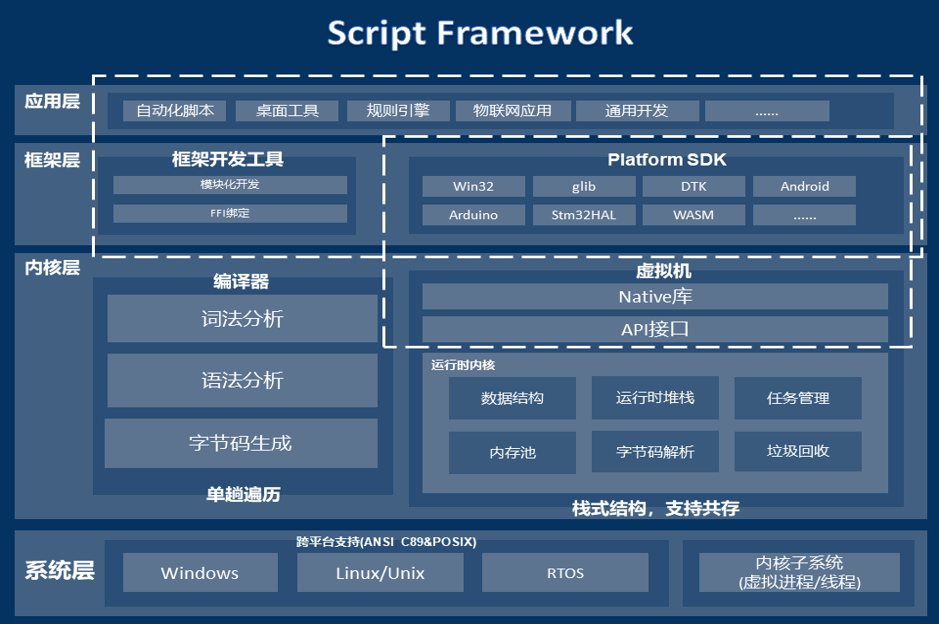
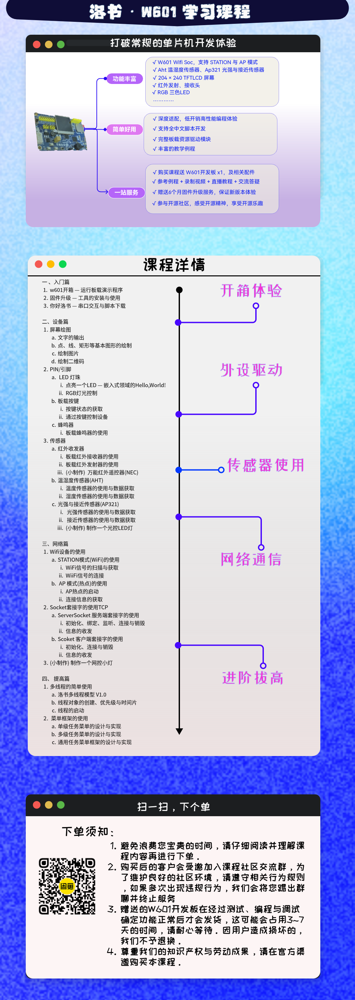

#!/bin/owls.wiki.losu.tech

# 洛 书 · L O S U
##  嵌入式中文脚本语言
##  开源 · 高效 · 强大

<a href='https://gitee.com/chen-chaochen/lpk/stargazers'></img></a>
<a href='https://gitee.com/chen-chaochen/lpk/members'></img></a><a href='https://gitee.com/chen-chaochen/lpk'>

<!-- 
|<a href="https://space.bilibili.com/1581765213">教学视频</a>|<a href = "#">文档手册</a>|<a href="https://gitee.com/neuq-losu">开发小组</a>|<a href="https://gitee.com/openkylin/easylosu">社区SIG</a>|<a href="https://zh-lang.osanswer.net/c/losu">编程论坛</a>| -->

# 简介
+ [官网](https://losu.tech)
+ [在线运行](https://losu.tech/playground)—— 在线体验 · 免安装 · 免配置 · 点开即玩
+ 代码仓库
    - [gitee](https://gitee.com/chen-chaochen/lpk)
    - [gitcode](https://gitcode.com/cthree/losu-lang)
    - [gitlink](https://www.gitlink.org.cn/cthree/lpk)

洛书(Losu) 编程语言，全称 Language Of Systemd Units ，超轻量、跨平台、易扩展、支持中文代码、拥有中文文档和视频资料，致力于打造一门开源、高效、强大的编程语言。

+ 洛书是一款：
    +  __图灵完备__ 的编程语言，支持面向过程、面向对象与部分元编程的特性
    + __全平台可用__，支持Windows、Linux、RTOS等多种操作系统，解释器可以由 __任何__ 遵循 __c99__ 标准的编译器编译通过并运行于任何拥有 __libc__ 的平台之上
    + __高性能__、__低开销__、__零依赖__，可以在低资源设备上运行 __完整__ 的内核，具备裸机运行能力。

# 快速开始？
+ 我们为您编译了常见平台的安装包，包括 Windows、Linux、Rt-thread等操作系统，x86、Arm、RISC-V、C-SKY、龙芯等CPU
+ 您可以访问洛书的 [官网](https://losu.tech) 以获取最新的二进制包，同时您可以参考 [文档中心](https://losu.tech/wiki/readme.md)中的
文档进行上手
+ 通过 [洛书在线运行平台](https://losu.tech/playground)，您可以不进行本地安装的情况下，对洛书进行体验。

<!-- ## 选购官方推出的学习套装

 -->

# 最新资讯
+ [洛书 2023 项目总结](https://mp.weixin.qq.com/s?__biz=MzkwNDY1ODk1NA==&mid=2247483665&idx=1&sn=0086aeae935a868a23e386d773a13479&chksm=c082e874f7f561623bd36018027103835a61a5b5946a3e500f9e834796934adfef78c658a9db&mpshare=1&scene=23&srcid=030100VSb6GExKmqxRwfed6u&sharer_shareinfo=3ebad755459b9dfe3cbeded9c667be35&sharer_shareinfo_first=3ebad755459b9dfe3cbeded9c667be35#rd)
+ [更稳定、更便捷、更 AI 的编程语言 — 洛书 24.1.4 阶段版本发布](https://www.oschina.net/news/278754/luoshu-24-1-4-released)
+ [聚沙成塔：洛书开源一周年版本 v1.6.8-alpha发布](https://www.oschina.net/news/252430)
+ [洛书 1.6.5 发布——十余项重要更新，第一个生产级标志性版本](https://www.oschina.net/news/245204)
+ [洛书 1.6.4 发布——全新SDK开发模式，统一的跨平台开发支持](https://gitee.com/chen-chaochen/lpk/releases/tag/v1.6.4)

# 文档手册

+ 我们为您准备了周期性的，随版本更新的文档
+ 前往[文档中心](https://losu.tech/wiki/readme.md)

# 贡献、交流与技术支持
## 贡献您的代码
+ 我们真诚地感谢您的每一份贡献，您可以参考[贡献文档](https://losu.tech/wiki/readme.md#contribute)中的流程参与代码贡献
+ 您可以贡献 demo,package,kernel，也可以帮助我们纠正完善文档
+ 您的贡献在通过审核后，将被合并入项目仓库。
## 不是只有代码才能参与贡献
+ 您可以在你的工作、个人项目、比赛中使用我们的产品
+ 您可以协助我们对作品进行宣传推广
+ 您可以给我们点个star
+ 请作者喝[生椰拿铁](https://afdian.net/a/cthreechen)
+ 体验、反馈、支持我们的产品

## 交流与支持
+ 通过创建 [issue](https://gitee.com/chen-chaochen/lpk/issues/new/) 向我们反馈，等待开发者的回复
+ 通过[邮箱](mailto:cthree2004@163.com)联系开发者
+ 加入官方QQ群，一起讨论，反馈，吹水，获得保姆级服务

# 感谢所有帮助过我们的热心人
